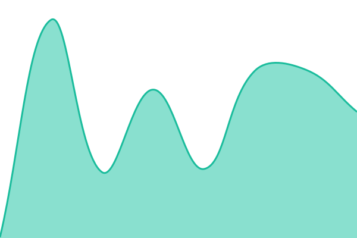
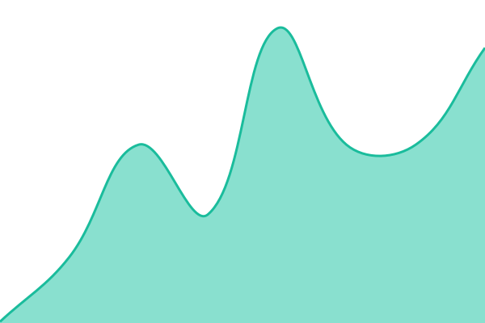
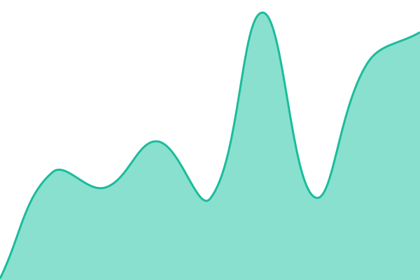
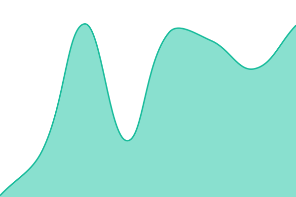
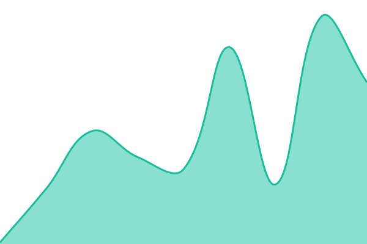

# [📈 Live Status](https://chimpanbeat.github.io/ohm-uptime): <!--live status--> **🟩 All systems operational**

This repository contains the open-source uptime monitor and status page for [chimpanbeat](https://chimpanbeat.github.io/ohm-uptime), powered by [Upptime](https://github.com/upptime/upptime).

With [Upptime](https://upptime.js.org), you can get your own unlimited and free uptime monitor and status page, powered entirely by a GitHub repository. We use [Issues](https://github.com/chimpanbeat/ohm-uptime/issues) as incident reports, [Actions](https://github.com/chimpanbeat/ohm-uptime/actions) as uptime monitors, and [Pages](https://chimpanbeat.github.io/ohm-uptime) for the status page.

<!--start: status pages-->
<!-- This summary is generated by Upptime (https://github.com/upptime/upptime) -->
<!-- Do not edit this manually, your changes will be overwritten -->
<!-- prettier-ignore -->
| URL | Status | History | Response Time | Uptime |
| --- | ------ | ------- | ------------- | ------ |
|  [Home](https://ohmprecisionbodywork.com/) | 🟩 Up | [home.yml](https://github.com/chimpanbeat/ohm-uptime/commits/HEAD/history/home.yml) | 

 174ms
     
 | 

<a href="https://chimpanbeat.github.io/ohm-uptime/history/home">100.00%</a>
    

|  [Book](https://ohmprecisionbodywork.com/book) | 🟩 Up | [book.yml](https://github.com/chimpanbeat/ohm-uptime/commits/HEAD/history/book.yml) | 

 116ms
     
 | 

<a href="https://chimpanbeat.github.io/ohm-uptime/history/book">100.00%</a>
    

|  [Hello](https://ohmprecisionbodywork.com/hello) | 🟩 Up | [hello.yml](https://github.com/chimpanbeat/ohm-uptime/commits/HEAD/history/hello.yml) | 

 95ms
     
 | 

<a href="https://chimpanbeat.github.io/ohm-uptime/history/hello">100.00%</a>
    

|  [Body map demo](https://ohmprecisionbodywork.com/body-map-demo) | 🟩 Up | [body-map-demo.yml](https://github.com/chimpanbeat/ohm-uptime/commits/HEAD/history/body-map-demo.yml) | 

 110ms
     
 | 

<a href="https://chimpanbeat.github.io/ohm-uptime/history/body-map-demo">100.00%</a>
    

|  [Event page](https://ohmprecisionbodywork.com/events/launch-party) | 🟩 Up | [event-page.yml](https://github.com/chimpanbeat/ohm-uptime/commits/HEAD/history/event-page.yml) | 

 94ms
     
 | 

<a href="https://chimpanbeat.github.io/ohm-uptime/history/event-page">100.00%</a>
    

|  [Short link shrug](https://ohmprecisionbodywork.com/shrug) | 🟩 Up | [short-link-shrug.yml](https://github.com/chimpanbeat/ohm-uptime/commits/HEAD/history/short-link-shrug.yml) | 

 76ms
     
 | 

<a href="https://chimpanbeat.github.io/ohm-uptime/history/short-link-shrug">100.00%</a>
    

|  [Short link card](https://ohmprecisionbodywork.com/card) | 🟩 Up | [short-link-card.yml](https://github.com/chimpanbeat/ohm-uptime/commits/HEAD/history/short-link-card.yml) | 

 80ms
     
 | 

<a href="https://chimpanbeat.github.io/ohm-uptime/history/short-link-card">100.00%</a>
    

|  [Short link ohm.mt card](https://ohm.mt/card) | 🟩 Up | [short-link-ohm-mt-card.yml](https://github.com/chimpanbeat/ohm-uptime/commits/HEAD/history/short-link-ohm-mt-card.yml) | 

 171ms
     
 | 

<a href="https://chimpanbeat.github.io/ohm-uptime/history/short-link-ohm-mt-card">100.00%</a>
    

<!--end: status pages-->

[**Visit our status website →**](https://chimpanbeat.github.io/ohm-uptime)

## 📄 License

- Powered by: [Upptime](https://github.com/upptime/upptime)
- Code: [MIT](./LICENSE) © [Anand Chowdhary](https://anandchowdhary.com)
- Data in the `./history` directory: [Open Database License](https://opendatacommons.org/licenses/odbl/1-0/)
